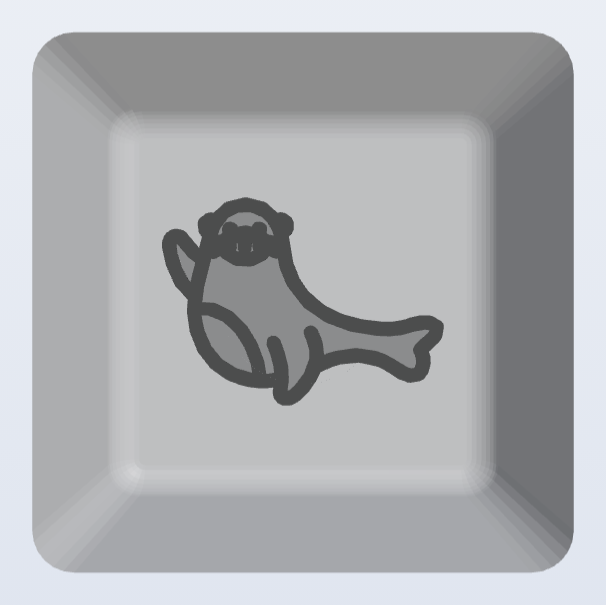
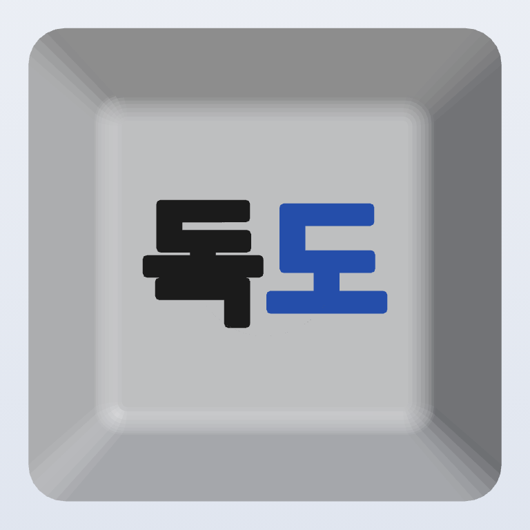
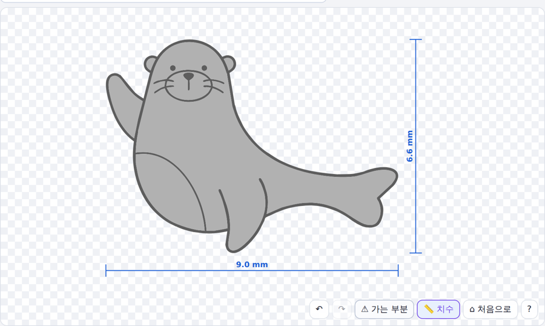
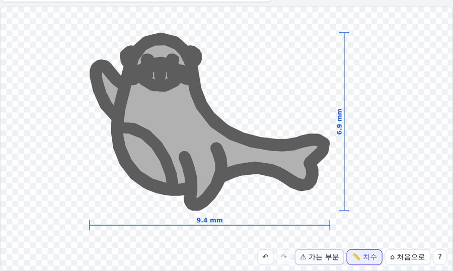
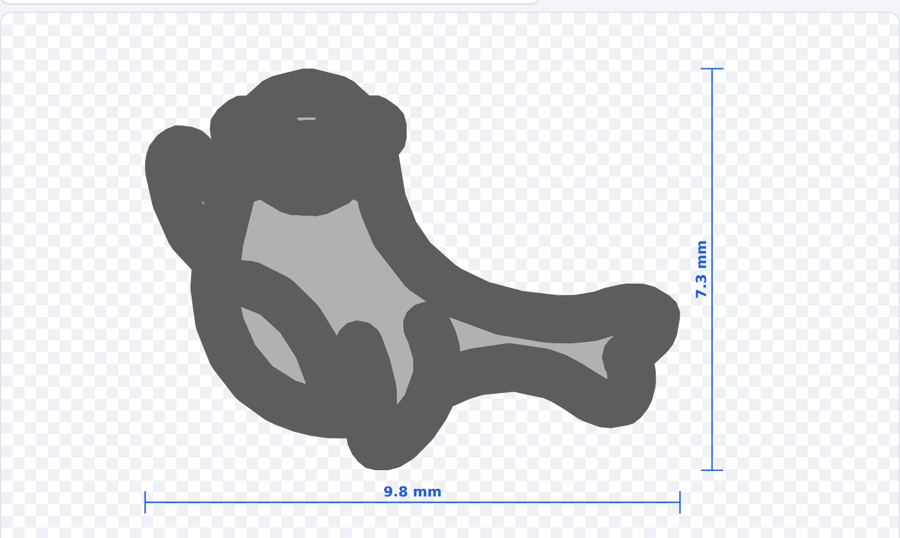

# 학생 수업 — 나만의 키캡 만들기

| 파일 | 내용 |
|---|---|
| [나만의-키캡-만들기.pptx](나만의-키캡-만들기.pptx) | 33장 · 물개 그림 키캡 + "독도" 글자 키캡 (학습 목표·트러블슈팅·루브릭·FAQ, 발표자 노트 포함) |

 

프로그램 조작이 처음이면 [1-프로그램-사용법](../1-프로그램-사용법/)을 먼저 훑어보세요.

## 수업 흐름

1. **시작** — 오늘 만들 키캡, 키캡 기본 크기(바닥 18.1 · 윗면 10.9 · 높이 9.5 · 최소 선 폭 0.8mm), 화면 구성, 다섯 단계
2. **활동 1 · 물개 그림 키캡** — 예시 그림: [images/seal-example.png](images/seal-example.png)
   1. 그림 열기 (색 수 자동 → 테두리 · 몸통 2색, 배경 제거)
   2. 모드 → **키캡 (MX 호환)** → 너비가 윗면에 맞게 9mm로
   3. 빨간 표시 확인 — 선이 약 0.05mm로 너무 가늚
   4. **선 굵게 하기 ★**: 선 클릭 → 범위 `이 색 전체` → 두께 칸 `0.2` → `+`
   5. 3D "위" 보기로 확인
3. **활동 2 · "독도" 글자 키캡**
   1. 텍스트 탭에 `독도` 입력, [한] 폰트
   2. 키캡 모드 + 왼쪽 **최소 획 폭 0.8**
   3. 🪣 채우기로 "도"를 다른 색 → 3MF 저장
4. **마무리** — 3MF/STL/프로젝트 저장, 스템 공차, 체크리스트, 단축키

## 선 굵게 하기 — 핵심 설명

- 두께 `+`는 도형을 **양쪽으로** 늘림 → 두께 칸 0.2 = 선 폭 **+0.4mm**
- 범위 `이 색 전체`면 같은 색 선이 한꺼번에 굵어짐 / `−` 또는 Ctrl+Z로 되돌리기
- 수염·눈처럼 아주 작은 부분은 굵히면 서로 붙음 → 먼저 Delete로 지우기
- 경고 옆 **가는 부분 보정 (0.8mm)** 버튼은 가는 곳만 자동으로 굵게

| 그대로 | + 한 번 (0.2) | + 두 번 (0.4) |
|---|---|---|
|  |  |  |
| 선 약 0.05mm — 출력 안 됨 | 선 약 0.45mm — 모양 유지 | 선 약 0.85mm — 얼굴이 뭉개짐 |

선 폭은 원본 그림의 선 두께로 계산한 대략값입니다.

> 1u 키캡에서는 0.8mm 기준과 그림 모양 사이에 선택이 필요합니다. 수업 전에 0.4~0.5mm 선이 실제 프린터에서 나오는지 시험 출력으로 확인하세요.

## 준비물

- 학생 PC + 크롬·엣지 (설치 불필요, 인터넷 없어도 동작)
- `dist/svg-forge.html` — USB로 배포
- 3D 프린터 1대 이상 (학급 공유 가능 — 3MF 파일만 모아서 출력)
- 예시 그림 PNG (배경이 단순한 것)

수업 시간: 40분이면 한 활동만, 80분이면 두 활동 + 출력 대기.
